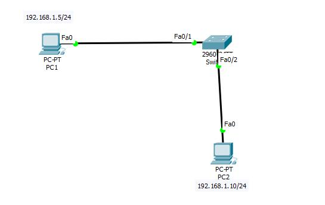

# Exercício 01 --- Comunicação entre dois hosts na mesma rede

**Domínio:** Fundamentos de redes\
**Dificuldade:** Nível 1 --- Fundamentos\
**Assuntos:** IPv4, máscara de sub-rede, switch, roteador, endereço MAC,
ARP e modelo OSI

## Objetivo

Entender como dois dispositivos conectados à mesma rede local (LAN)
conseguem se comunicar, identificar quando a comunicação exige um
roteador e reconhecer o papel dos endereços IP e MAC na entrega dos
dados.

## Cenário

Dois computadores estão conectados ao mesmo switch Ethernet. Ambos
possuem endereços IPv4 pertencentes à mesma rede.

``` text

```

Configurações de rede:

  Configuração          PC1               PC2
  --------------------- ----------------- -----------------
  Endereço IPv4         `192.168.1.10`    `192.168.1.20`
  Máscara de sub-rede   `255.255.255.0`   `255.255.255.0`
  Gateway padrão        `192.168.1.1`     `192.168.1.1`

O PC1 precisa enviar dados ao PC2.

## Questões

Responda às cinco questões usando suas próprias palavras. Justifique as
respostas sempre que possível.

### 1. Comunicação dentro da mesma rede

Os dados precisam passar por um roteador para que o PC1 alcance o PC2?

Explique por que o roteador é ou não necessário nesse cenário.

**Resposta:**

> Escreva sua resposta aqui.

### 2. Modelo OSI

Quais camadas do modelo OSI participam do processo de entrega dos dados
do PC1 ao PC2?

Explique brevemente a função de cada camada que você mencionar.

**Resposta:**

> Escreva sua resposta aqui.

### 3. Endereço MAC de destino

Qual endereço MAC o PC1 deverá utilizar como destino no quadro Ethernet
enviado ao PC2?

Explique a relação entre o endereço IP de destino e o endereço MAC de
destino nesse cenário.

**Resposta:**

> Escreva sua resposta aqui.

### 4. Descoberta do endereço MAC

Imagine que o PC1 conhece o endereço IP do PC2, mas ainda não conhece
seu endereço MAC.

Qual protocolo o PC1 utilizará para descobrir o endereço MAC
correspondente ao IP do PC2?

Descreva resumidamente como esse processo funciona.

**Resposta:**

> Escreva sua resposta aqui.

### 5. Alteração da máscara de sub-rede

Agora considere que a máscara de sub-rede do PC1 foi alterada
incorretamente para `255.255.255.192`, enquanto o PC2 continua
utilizando `255.255.255.0`.

O que pode acontecer quando o PC1 tentar se comunicar com o PC2?

Explique como a máscara influencia a decisão de enviar os dados
diretamente ao destino ou encaminhá-los para o gateway padrão.

**Resposta:**

> Escreva sua resposta aqui.

------------------------------------------------------------------------

## Critérios de conclusão

Antes de considerar o exercício concluído, verifique se você consegue:

-   [ ] Explicar a diferença entre comunicação na mesma rede e
    comunicação entre redes diferentes.
-   [ ] Explicar por que um switch Layer 2 pode encaminhar quadros
    dentro de uma LAN sem utilizar um roteador.
-   [ ] Diferenciar endereço IPv4 de endereço MAC.
-   [ ] Explicar a finalidade do ARP em redes IPv4.
-   [ ] Explicar como a máscara de sub-rede influencia a decisão de
    encaminhamento de um host.

## Conceitos para revisar

Caso tenha dificuldade, revise:

-   Endereços IPv4 e máscaras de sub-rede.
-   Identificação da rede e do host.
-   Funcionamento básico de switches Ethernet.
-   Diferença entre switch e roteador.
-   Endereços MAC e quadros Ethernet.
-   ARP (*Address Resolution Protocol*).
-   Encapsulamento e modelo OSI.

## Registro da resolução

Depois de receber a correção, registre aqui o que aprendeu, os erros
identificados e os pontos que precisam de revisão.

**O que aprendi:**

> Preencha após a correção.

**Pontos que preciso revisar:**

> Preencha após a correção.

**Referências:**

> Adicione links ou materiais consultados.

------------------------------------------------------------------------

**Status:** Proposto --- aguardando resolução.
